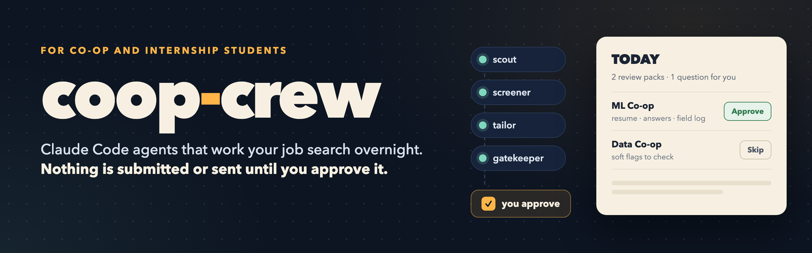
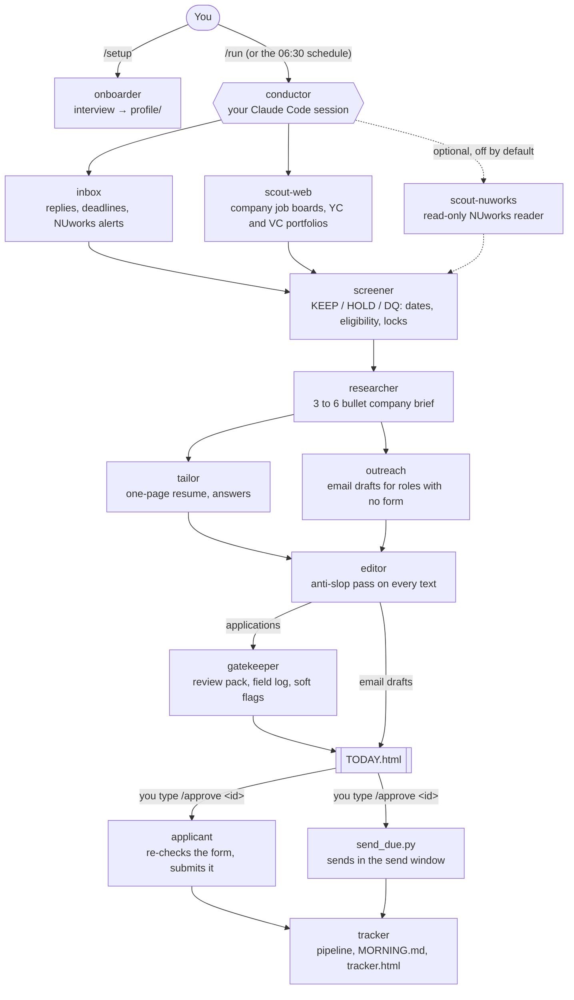

<p align="center">
  
</p>

<p align="center">
  <a href="https://github.com/dudailia/coop-crew/actions/workflows/tests.yml"></a>
  <a href="LICENSE"></a>
  <a href="#step-by-step"></a>
  <a href="https://github.com/dudailia/coop-crew/releases/latest"></a>
</p>

# coop-crew

**A crew of Claude Code agents that works your co-op and internship search overnight.**
It finds roles on company job boards and in your NUworks job-alert emails, researches each company, and prepares a
one-page resume, the form answers and any outreach email. You read one page in the morning and approve what is right.
**Nothing is submitted or sent until you approve that exact item.**

## Quickstart

You need a Mac, Linux, or Windows with WSL, and a paid Claude plan (Pro or Max). No API key.

1. **Install Claude Code**, then run `claude` once to sign in:
   ```
   curl -fsSL https://claude.ai/install.sh | bash
   ```
2. **Get coop-crew** (about 5 minutes):
   ```
   git clone https://github.com/dudailia/coop-crew
   cd coop-crew
   ./install.sh
   ```
3. **Start it**: type `claude` in the folder, choose **Yes, I trust this folder**, then type `/demo --offline` to see
   it work on a made-up student, and `/setup` to make it yours.

First time in a terminal, or something did not work? Follow the [step-by-step version](#step-by-step) below.


*The offline demo on the bundled sample student. The student and every company are made up. The full 60-second video,
with captions, is attached to the [latest release](https://github.com/dudailia/coop-crew/releases/latest).*

## What it does

- **Finds roles** on company-run boards (Greenhouse, Lever, Ashby, Workable and others, through their public APIs), in
  YC and VC portfolios, and in the NUworks job-alert emails you already get from your saved searches.
- **Screens each role** against your co-op dates, cycle, work authorization, cities, pay floor and your own rules, and
  either keeps it, drops it with the reason, or asks you one exact question.
- **Researches the company** (3 to 6 bullets from the posting and the company's own site) and finds at most one named
  person with a verified source.
- **Builds the application**: a one-page ATS resume from your confirmed facts only, the portal's answers, a log of every
  form field and where its value came from, and soft flags you should know before you approve.
- **Drafts outreach** for strong companies with no form, and follow-ups 5 to 7 working days later, cancelled by a reply.
- **Shows it all on one page**, `TODAY.html`, every morning, with a tracker of everything that happened.

## What it never does

- **It never submits an application or sends an email you did not approve.** Approval is you typing `/approve <id>`
  for that exact item. A ready pack, a passed check or "looks good" is not approval.
- **It never automates NUworks by default.** It reads only your own job-alert emails and the postings you save yourself,
  and you always apply in NUworks yourself. The optional browser reader ships off (see the NUworks rules under
  [Advanced](#advanced)).
- **It never makes things up.** Every number and name in a resume, answer or email must be in your `profile/facts.md`
  or the posting, or the build fails. Your work-authorization sentence is used word for word.
- **It never drafts an answer that must be your own work written without AI.** Those go to you.
- **It never touches LinkedIn, job aggregators, or anything behind a login**, and never buys or guesses email addresses.
- **It never sends your data anywhere but your own Claude plan.** Your profile, resumes and pipeline stay on your
  machine and are never committed.

## Commands

Type these inside Claude Code, in the coop-crew folder.

| Command | What it does |
|---|---|
| `/setup` | The interview, your profile, optional schedules, then a dry run |
| `/run` | One full daily cycle: inbox, scouts, screening, research, resumes, review packs, outreach drafts |
| `/today` | Opens TODAY.html, MORNING.md and needs-reply.html |
| `/approve <ids>` | Approves those applications or emails, and nothing else |
| `/skip <ids>` | Closes items without submitting |
| `/stop` | Kill switch on: every job stops at its next step |
| `/crew-resume` | Kill switch off |
| `/demo` | The five-minute demo on a sample student (`/demo --offline`: the same in seconds, no agents) |
| `/crew-doctor` | Health check: tools, logins, schedules, disk, kill switch, last run |

## How it works

Your Claude Code session is the conductor. It hands each specialist agent one job; the agents hand off through files
and one SQLite pipeline; a guard hook checks every tool call. Nothing leaves your machine until you approve it.



1. **`/setup`** writes your profile. Every claim the crew ever makes about you comes from it.
2. **`/run`** (by hand, or scheduled at 06:30) runs the crew in that order.
3. **TODAY.html** is the result: questions for you, and review packs with the brief, the resume, the answers, soft flags
   and the field log.
4. **`/approve <id>`** is the only way anything leaves: the applicant re-checks that form and submits it, and an approved
   email goes out in its send window.

Twelve agents in `.claude/agents/`, six skills in `.claude/skills/`, nine commands in `.claude/commands/`, Python
tools (standard library only) in `tools/`. More in [docs/architecture.md](docs/architecture.md) and
[docs/agents.md](docs/agents.md).

## Step by step

New to Claude Code? Start here. Each step says what you should see.

1. **Install the basics** (skip what you have):
   - macOS: `xcode-select --install` (gives you git and Python 3), then Node.js 22 from [nodejs.org](https://nodejs.org).
   - Ubuntu or WSL: `sudo apt install git python3`, then Node.js 22 from nodejs.org or `nvm install 22`.
   - Windows: install WSL (`wsl --install` in PowerShell as administrator), then follow the Ubuntu line inside it.
2. **Install Claude Code** (on Windows, inside the WSL terminal) and sign in with your Claude account:
   ```
   curl -fsSL https://claude.ai/install.sh | bash
   ```
   If the installer ends with a note that `~/.local/bin` is not in your PATH (it does on a new Mac), run the one line it
   prints, for example `echo 'export PATH="$HOME/.local/bin:$PATH"' >> ~/.zshrc && source ~/.zshrc`. Then open a new
   terminal and check it with `claude --version`: it prints a version number. Run `claude` once, follow the browser
   prompts to sign in, and type `/exit`. Other ways to install (Homebrew, WinGet) are on the official setup page,
   [code.claude.com/docs/en/setup](https://code.claude.com/docs/en/setup).
3. **Get coop-crew and install it** (5 minutes or so: it downloads about 280 MB, mostly a browser engine for the PDFs):
   ```
   git clone https://github.com/dudailia/coop-crew
   cd coop-crew
   ./install.sh
   ```
   The installer checks Python, Node and git, installs what the crew needs, runs a health check and prints one next
   step. On Windows, run `.\install.ps1` in PowerShell instead.
4. **Start Claude Code in the folder**: type `claude`. It asks whether you trust this folder and lists the permissions
   and the hook the folder sets up: those are the crew's allowed tools and its safety guard. The highlighted answer is
   "No, exit", so press the down arrow to choose **Yes, I trust this folder**, then Enter. The crew's permissions and its
   safety hook load only in a trusted folder.
5. **Watch the demo**: type `/demo`. In about five minutes the crew works on a made-up student and opens `TODAY.html`.
   It submits and sends nothing. Short on time, or the network is slow? Type `/demo --offline`: the same pages in a few
   seconds, from cached boards and rules in code instead of agents. No Claude access at all? Run
   `python3 -I tools/demo.py run --offline` in a terminal.
6. **Make it yours**: type `/setup`. A 30-minute interview, one group of questions at a time (program, co-op dates,
   work authorization, targets, the facts you can defend, your rules, your voice). Then `/run` each morning, or turn
   on the 06:30 schedule at the end of `/setup`.

Something wrong? Type `/crew-doctor`. [GUIDE.md](GUIDE.md) has every step in detail;
[docs/talk/BEFORE-THE-TALK.md](docs/talk/BEFORE-THE-TALK.md) lists common install errors and their fixes.
Questions? Ask in [Discussions](https://github.com/dudailia/coop-crew/discussions).

## Using this at another school

coop-crew is built around Northeastern's co-op, but nothing in it needs NUworks. Without it, the crew finds roles on
company job boards and in YC and VC portfolios, as it does for any student. What to change:

- **Choose "external only" in `/setup`** (sourcing mode b, which is also the default). The NUworks alert reader, the
  "Apply in NUworks" buttons and the NUworks browser reader then never come into play. Say no when `/setup` asks about
  the NUworks recruitment term.
- **Give your own term and exact dates.** The screener checks every role against your start and end dates. In code, a
  spring or fall cycle also drops summer-only internships and roles titled for the other term ("Spring 2027" for a
  fall co-op). For a summer internship, give the cycle as summer and those two rules stay out of the way.
- **Skip the self-developed co-op mode.** Its banned-list check searches northeastern.edu, so it means nothing
  elsewhere. To adapt it, change the searches in `.claude/skills/banned-check/SKILL.md` and `tools/banned.py`.
- **Add your school's email domain** to `audit.generic_domains` in `profile/settings.json` (it ships with
  `northeastern.edu` and `husky.neu.edu`). The inbox audit then knows a later email from someone else at your school
  is not a reply from the person you wrote to.
- **Work authorization is per country.** `/setup` writes your sentence word for word for each country you target. The
  F-1 CPT wording is for US co-ops. The place rules recognize US states and cities by name; anywhere else, list your
  target cities in `/setup` and a role must name one of them.
- **Your school's own job board** is not read. Apply there yourself, as Northeastern students do in NUworks.

Use the green **Use this template** button to start your own copy. Forks and pull requests that add another school's
rules are welcome; see [CONTRIBUTING.md](CONTRIBUTING.md).

## FAQ

<details>
<summary><b>Does it apply for me?</b></summary>

It prepares each application (resume, answers, the filled form) and submits only the ones you approve, one id at a
time, with `/approve <id>`. NUworks applications you always submit yourself in NUworks.
</details>

<details>
<summary><b>Does it send emails?</b></summary>

In prepare mode (the default) it only saves drafts you send yourself. Even in send mode (Mac Mail only) it sends only
emails you approved, in the recipient's morning window, at most 10 a day by default and never more than 40.
</details>

<details>
<summary><b>Can it make things up?</b></summary>

Every number and name in a resume, answer or email must be in your `profile/facts.md` or the posting; the checker and
the resume build fail otherwise. Work authorization is your own sentence, word for word.
</details>

<details>
<summary><b>Where does my data go?</b></summary>

Your profile, resumes, pipeline and logs stay in the folder on your machine and are gitignored. The agents run on your
own Claude plan. The crew's rules forbid putting your name, email, phone or other details in a web search or a URL.
</details>

<details>
<summary><b>What does it cost?</b></summary>

The code is free (MIT). It runs on your own Claude plan (Pro or Max); a daily `/run` uses a good share of a Pro plan's
limits. There is no API-key mode.
</details>

<details>
<summary><b>How does it use NUworks? Is the browser reader allowed?</b></summary>

By default only through your own email and files: the inbox agent reads NUworks job-alert emails (from searches you
saved in NUworks) and postings you save from NUworks into `data/nuworks-import/`. No NUworks page is loaded, and you
apply in NUworks yourself. Symplicity's terms of use, which govern NUworks, prohibit automated access without
Symplicity's prior permission, so the read-only browser reader stays off. It turns on only if you type an
acknowledgement after a notice that quotes those terms ([mcp/nuworks/APPROVAL.md](mcp/nuworks/APPROVAL.md)).
</details>

<details>
<summary><b>Does it use LinkedIn?</b></summary>

It never automates or scrapes LinkedIn. It may draft one note to a person with a verified profile; you send it by hand.
</details>

<details>
<summary><b>How do I stop it?</b></summary>

Type `/stop` (or create a file named `STOP` in the folder). Every job stops at its next step. `/crew-resume` turns it
back on.
</details>

<details>
<summary><b>Does it work on Windows?</b></summary>

Yes, through WSL (`install.ps1`). Email is written as `.eml` drafts you open in your own client.
</details>

More answers in [docs/FAQ.md](docs/FAQ.md).

## Advanced

<details>
<summary><b>Safety and the kill switch</b></summary>

- **Prepare mode by default.** A form is submitted only by `tools/applicant.py`, for an id you approved, after the
  review gate passes and the form is re-checked. An email goes only through `tools/send_due.py`, for an id you approved,
  inside its send window, under the daily caps (5 applications and 10 emails by default; never more than 40 emails a
  day).
- **A guard hook** (`tools/guard.py`) runs before every agent tool call. It blocks submitting, sending, approving,
  editing the pipeline or the safety files any other way, AppleScript, and fetching NUworks or LinkedIn.
- **The kill switch.** `/stop` (or a file named `STOP` in the folder) stops every job at its next step and blocks every
  acting tool call. Only you turn it off, with `/crew-resume`.
- **Your data stays on your machine.** `profile/`, `data/`, `out/`, `logs/` and the pages are gitignored. Mail is read,
  never changed: the inbox audit never sends, moves, deletes or marks anything.

More in [SECURITY.md](SECURITY.md).
</details>

<details>
<summary><b>Northeastern rules it enforces</b></summary>

- **Co-op dates and cycle.** A role must fit your exact co-op dates and cycle (spring or fall, 4 or 6 months).
  Summer-only internships are dropped for a spring or fall co-op, and a role that would end early becomes a question
  for you.
- **NUworks: you apply yourself.** NUworks roles get a tailored pack and an "Apply in NUworks" button. The crew never
  applies, messages or uploads in NUworks, and it knows you can apply only in your recruitment term.
- **NUworks within Symplicity's terms.** Symplicity's terms of use, which govern NUworks, prohibit automated access
  without Symplicity's written permission. So by default NUworks comes only from your own job-alert emails and the
  postings you save. The read-only browser reader ships off; it turns on only after a notice that quotes those terms
  and an acknowledgement you type yourself ([mcp/nuworks/APPROVAL.md](mcp/nuworks/APPROVAL.md),
  [GUIDE.md](GUIDE.md#nuworks)).
- **Self-developed co-ops.** In that mode no employer that already recruits through NUworks is pursued: each one is
  checked against your banned list (under any spelling) and with three web checks.
- **Work authorization, word for word.** F-1 students: the visa type is "F-1 CPT", and H-1B is never given as your type.
- **Academic integrity.** Any question that asks you to confirm an answer is your own work, written without AI, is
  never drafted; it is left for you.
</details>

<details>
<summary><b>Limits</b></summary>

- **It runs on your Claude plan.** A daily `/run` uses a good share of a Pro plan's limits. There is no API-key mode.
- **It only submits forms the form filler supports.** jev-job-search (Node 22+) fills supported portals in prepare mode;
  anything else stays a review pack you submit yourself from TODAY.html.
- **Email sending needs Apple Mail on a Mac.** Elsewhere, outreach writes `.eml` drafts you send from your own client.
- **LinkedIn notes are yours to send.** The crew drafts at most one, to a person with a verified profile.
- **Agents can be wrong.** The screener, researcher and tailor make judgment calls. Every pack says why, with the
  source; read it before you approve. The checker catches invented numbers and names, not a weak argument.
- **NUworks alerts list only the title, employer and location.** For the full posting, save it from NUworks into
  `data/nuworks-import/`.
- **Not affiliated** with Northeastern University, Symplicity or Anthropic, and not a substitute for your co-op advisor.
</details>

<details>
<summary><b>Tests</b></summary>

Every push runs the tests on Python 3.9 and 3.13 ([the workflow](.github/workflows/tests.yml)). To run them yourself:

```
python3 -m unittest discover -s tests -v     # acceptance and rule tests: approvals, guard, NUworks default path
npm run test:nuworks                         # the NUworks server against a local fake site
tests/acceptance_fresh_install.sh            # fresh clone + empty HOME: install and demo, timed
tests/acceptance_linux_docker.sh             # the same install on Ubuntu (WSL stand-in) + the .eml adapter
python3 -I tools/pii_scan.py                 # personal-data scan of the tree and the git history
```
</details>

<details>
<summary><b>Talk materials and the demo video</b></summary>

[docs/talk/](docs/talk/): the slide deck (`slides.html`, works offline, arrow keys), the spoken demo script with a
no-Wi-Fi plan, and the attendee pre-install note. The recorded demo (`demo.mp4`) is attached to the
[latest release](https://github.com/dudailia/coop-crew/releases/latest). `tools/record_demo.sh --offline` records a new
video and README GIF frame by frame from the offline demo.
</details>

## Contributing, security, license

Issues and pull requests are welcome: see [CONTRIBUTING.md](CONTRIBUTING.md), and the [CHANGELOG](CHANGELOG.md) for
what changed. Questions go to [Discussions](https://github.com/dudailia/coop-crew/discussions). Report a safety problem
privately, as [SECURITY.md](SECURITY.md) describes. MIT licensed ([LICENSE](LICENSE)). Built on jev-job-search by
Qendrim Beka (MIT), job-agents-kit, and the job-applications and anti-slop skills (MIT, contributed with the author's
permission); see [THIRD_PARTY.md](THIRD_PARTY.md).
