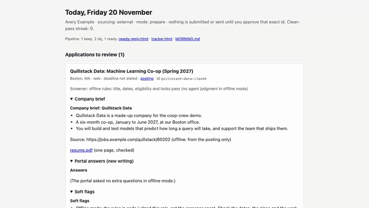

# coop-crew

**A crew of Claude Code agents that works your co-op and internship search overnight.**
It finds roles on company job boards and in your NUworks job-alert emails, researches each company, and prepares a
one-page resume, the form answers and any outreach email. You read one page in the morning and approve what is right.
**Nothing is submitted or sent until you approve that exact item.**



*The offline demo on the bundled sample student. The student and every company are made up. The full 78-second video,
with captions, is attached to the [v1.0 release](https://github.com/dudailia/coop-crew/releases/tag/v1.0).*

## What it does

- **Finds roles** on company-run boards (Greenhouse, Lever, Ashby, Workable and others, through their public APIs), in
  YC and VC portfolios, and in the NUworks job-alert emails you already get from your saved searches.
- **Screens each role** against your co-op dates, cycle, work authorization, cities, pay floor and your own rules, and
  either keeps it, drops it with the reason, or asks you one exact question.
- **Researches the company** (3 to 6 bullets from the posting and the company's own site) and finds at most one named
  person with a verified source.
- **Builds the application**: a one-page ATS resume from your confirmed facts only, the portal's answers, a log of every
  form field and where its value came from, and soft flags you should know before you approve.
- **Drafts outreach** for strong companies with no form, and follow-ups 5 to 7 working days later, cancelled by a reply.
- **Shows it all on one page**, `TODAY.html`, every morning, with a tracker of everything that happened.

## What it never does

- **It never submits an application or sends an email you did not approve.** Approval is you typing `/approve <id>`
  for that exact item. A ready pack, a passed check or "looks good" is not approval.
- **It never automates NUworks by default.** It reads only your own job-alert emails and the postings you save yourself,
  and you always apply in NUworks yourself. The optional browser reader ships off (see [NUworks](#northeastern-rules-it-enforces)).
- **It never makes things up.** Every number and name in a resume, answer or email must be in your `profile/facts.md`
  or the posting, or the build fails. Your work-authorization sentence is used word for word.
- **It never drafts an answer that must be your own work written without AI.** Those go to you.
- **It never touches LinkedIn, job aggregators, or anything behind a login**, and never buys or guesses email addresses.
- **It never sends your data anywhere but your own Claude plan.** Your profile, resumes and pipeline stay on your
  machine and are never committed.

## Quickstart (new to Claude Code? start here)

You need a Mac, Linux, or Windows with WSL, and a paid Claude plan (Pro or Max). No API key.

1. **Install the basics** (skip what you have):
   - macOS: `xcode-select --install` (gives you git and Python 3), then Node.js 22 from [nodejs.org](https://nodejs.org).
   - Ubuntu or WSL: `sudo apt install git python3`, then Node.js 22 from nodejs.org or `nvm install 22`.
   - Windows: install WSL (`wsl --install` in PowerShell as administrator), then follow the Ubuntu line inside it.
2. **Install Claude Code** (on Windows, inside the WSL terminal) and sign in with your Claude account:
   ```
   curl -fsSL https://claude.ai/install.sh | bash
   ```
   Open a new terminal and check it with `claude --version`. Then run `claude` once and follow the browser prompts to
   sign in, and type `/exit`. Other ways to install (Homebrew, npm) are on the official setup page,
   [code.claude.com/docs/en/setup](https://code.claude.com/docs/en/setup).
3. **Get coop-crew and install it** (about a minute):
   ```
   git clone https://github.com/dudailia/coop-crew
   cd coop-crew
   ./install.sh
   ```
   The installer checks Python, Node and git, installs what the crew needs, runs a health check and prints one next
   step. On Windows, run `.\install.ps1` in PowerShell instead.
4. **Start Claude Code in the folder**: type `claude`. When it asks whether you trust this folder, say yes: the crew's
   permissions and its safety hook load only in a trusted folder.
5. **Watch the demo**: type `/demo`. In about five minutes the crew works on a made-up student and opens `TODAY.html`.
   It submits and sends nothing. No network or no Claude access? Run `python3 -I tools/demo.py run --offline` in a
   terminal instead: the same pages in a few seconds, from rules in code instead of agents.
6. **Make it yours**: type `/setup`. A 30-minute interview, one group of questions at a time (program, co-op dates,
   work authorization, targets, the facts you can defend, your rules, your voice). Then `/run` each morning, or turn
   on the 06:30 schedule at the end of `/setup`.

Something wrong? Type `/crew-doctor`. [GUIDE.md](GUIDE.md) has every step in detail;
[docs/talk/BEFORE-THE-TALK.md](docs/talk/BEFORE-THE-TALK.md) lists common install errors and their fixes.

## Commands

Type these inside Claude Code, in the coop-crew folder.

| Command | What it does |
|---|---|
| `/setup` | The interview, your profile, optional schedules, then a dry run |
| `/run` | One full daily cycle: inbox, scouts, screening, research, resumes, review packs, outreach drafts |
| `/today` | Opens TODAY.html, MORNING.md and needs-reply.html |
| `/approve <ids>` | Approves those applications or emails, and nothing else |
| `/skip <ids>` | Closes items without submitting |
| `/stop` | Kill switch on: every job stops at its next step |
| `/crew-resume` | Kill switch off |
| `/demo` | The five-minute demo on a sample student |
| `/crew-doctor` | Health check: tools, logins, schedules, disk, kill switch, last run |

## How it works

1. **`/setup`** writes your profile. Every claim the crew ever makes about you comes from it.
2. **`/run`** (by hand, or scheduled at 06:30) runs the crew: the conductor (your Claude Code session) hands each agent
   one job, and the agents hand off through files and one SQLite pipeline.
3. **TODAY.html** is the result: questions for you, and review packs with the brief, the resume, the answers, soft flags
   and the field log.
4. **`/approve <id>`** is the only way anything leaves: the applicant re-checks that form and submits it, and an approved
   email goes out in its send window.

```
   you ── /setup /run /approve ──> conductor (main Claude Code session)
                                      │
   onboarder → profile/          inbox (replies, deadlines, NUworks alerts)
                                      │
   scout-web ─┐                       │
   scout-nuworks (optional, off) ─┴─> screener (KEEP / HOLD / DQ: dates, eligibility, locks)
                                      │
                                 researcher (3 to 6 bullet company brief)
                                      │
                                 tailor (one-page resume, answers) → editor (anti-slop)
                                      │
                                 gatekeeper (review pack) ──> TODAY.html: you approve or skip
                                      │
              applicant (submits approved forms)   outreach (drafts emails, plans sends)
                                      │
                                 tracker (pipeline, MORNING.md, tracker.html)
```

Twelve agents in `.claude/agents/`, six skills in `.claude/skills/`, the commands in `.claude/commands/`, Python tools
(standard library only) in `tools/`. More in [docs/architecture.md](docs/architecture.md) and
[docs/agents.md](docs/agents.md).

## Safety and the kill switch

- **Prepare mode by default.** A form is submitted only by `tools/applicant.py`, for an id you approved, after the
  review gate passes and the form is re-checked. An email goes only through `tools/send_due.py`, for an id you approved,
  inside its send window, under the daily caps (5 applications and 10 emails by default; never more than 40 emails a
  day).
- **A guard hook** (`tools/guard.py`) runs before every agent tool call. It blocks submitting, sending, approving,
  editing the pipeline or the safety files any other way, AppleScript, and fetching NUworks or LinkedIn.
- **The kill switch.** `/stop` (or a file named `STOP` in the folder) stops every job at its next step and blocks every
  acting tool call. Only you turn it off, with `/crew-resume`.
- **Your data stays on your machine.** `profile/`, `data/`, `out/`, `logs/` and the pages are gitignored. Mail is read,
  never changed: the inbox audit never sends, moves, deletes or marks anything.

More in [SECURITY.md](SECURITY.md).

## Northeastern rules it enforces

- **Co-op dates and cycle.** A role must fit your exact co-op dates and cycle (spring or fall, 4 or 6 months).
  Summer-only internships are dropped for a spring or fall co-op, and a role that would end early becomes a question
  for you.
- **NUworks: you apply yourself.** NUworks roles get a tailored pack and an "Apply in NUworks" button. The crew never
  applies, messages or uploads in NUworks, and it knows you can apply only in your recruitment term.
- **NUworks within Symplicity's terms.** Symplicity's terms of use, which govern NUworks, prohibit automated access
  without Symplicity's written permission. So by default NUworks comes only from your own job-alert emails and the
  postings you save. The read-only browser reader ships off; it turns on only after a notice that quotes those terms
  and an acknowledgement you type yourself ([mcp/nuworks/APPROVAL.md](mcp/nuworks/APPROVAL.md),
  [GUIDE.md](GUIDE.md#nuworks)).
- **Self-developed co-ops.** In that mode no employer that already recruits through NUworks is pursued: each one is
  checked against your banned list (under any spelling) and with three web checks.
- **Work authorization, word for word.** F-1 students: the visa type is "F-1 CPT", and H-1B is never given as your type.
- **Academic integrity.** Any question that asks you to confirm an answer is your own work, written without AI, is
  never drafted; it is left for you.

## Limits

- **It runs on your Claude plan.** A daily `/run` uses a good share of a Pro plan's limits. There is no API-key mode.
- **It only submits forms the form filler supports.** jev-job-search (Node 22+) fills supported portals in prepare mode;
  anything else stays a review pack you submit yourself from TODAY.html.
- **Email sending needs Apple Mail on a Mac.** Elsewhere, outreach writes `.eml` drafts you send from your own client.
- **LinkedIn notes are yours to send.** The crew drafts at most one, to a person with a verified profile.
- **Agents can be wrong.** The screener, researcher and tailor make judgment calls. Every pack says why, with the
  source; read it before you approve. The checker catches invented numbers and names, not a weak argument.
- **NUworks alerts list only the title, employer and location.** For the full posting, save it from NUworks into
  `data/nuworks-import/`.
- **Not affiliated** with Northeastern University or Symplicity, and not a substitute for your co-op advisor.

## Talk materials

[docs/talk/](docs/talk/): the slide deck (`slides.html`, works offline, arrow keys), the spoken demo script with a
no-Wi-Fi plan, and the attendee pre-install note. The recorded demo (`demo.mp4`) is attached to the
[v1.0 release](https://github.com/dudailia/coop-crew/releases/tag/v1.0); `tools/record_demo.sh` records a new one.

## Tests

```
python3 -m unittest discover -s tests -v     # acceptance and rule tests: approvals, guard, NUworks default path
npm run test:nuworks                         # the NUworks server against a local fake site
tests/acceptance_fresh_install.sh            # fresh clone + empty HOME: install and demo, timed
tests/acceptance_linux_docker.sh             # the same install on Ubuntu (WSL stand-in) + the .eml adapter
python3 -I tools/pii_scan.py                 # personal-data scan of the tree and the git history
```

## Contributing, security, license

Issues and pull requests are welcome: see [CONTRIBUTING.md](CONTRIBUTING.md). Report a safety problem privately, as
[SECURITY.md](SECURITY.md) describes. MIT licensed ([LICENSE](LICENSE)). Built on jev-job-search by Qendrim Beka (MIT),
job-agents-kit, and the job-applications and anti-slop skills (MIT, contributed with the author's permission); see
[THIRD_PARTY.md](THIRD_PARTY.md).
