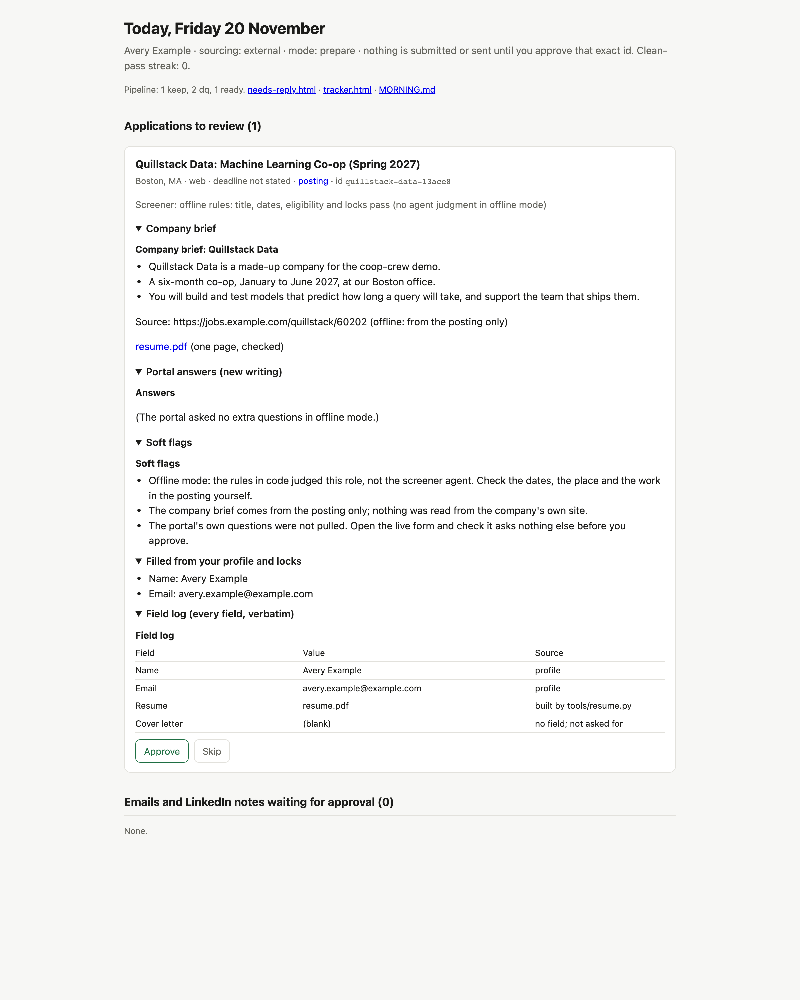
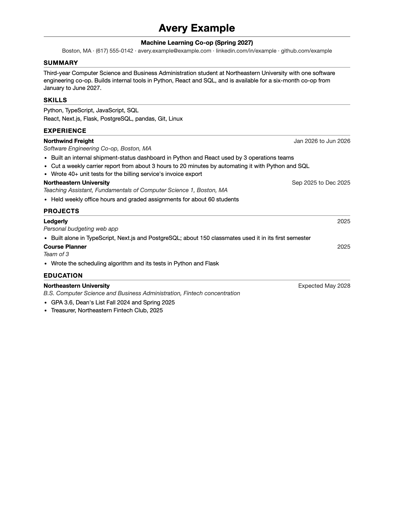
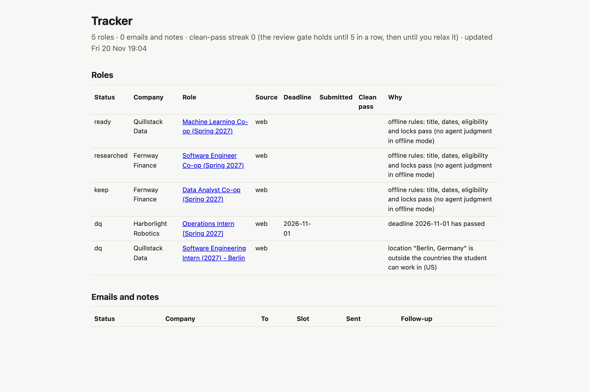

# coop-crew

A multi-agent co-op and internship search for students, built on [Claude Code](https://claude.com/claude-code).
You answer an interview about your major, co-op cycle and goals. Then a crew of agents finds roles on company job
boards and in your NUworks job-alert emails, researches each company, writes a one-page ATS resume and the answers each
application asks for, prepares the application and any outreach email, and reads your inbox for replies.

**Nothing is submitted or sent without your approval of that exact item.** You spend about 20 minutes a day reading
one page and typing `/approve <id>` for what is right.

| Review pack in TODAY.html | One-page resume (Option A header) | Tracker |
|---|---|---|
|  |  |  |

*Screenshots show the bundled sample student. Every detail in them is made up.*

## Install (one command)

```
git clone https://github.com/dudailia/coop-crew && cd coop-crew && ./install.sh && claude
```

Then type `/setup`. Or type `/demo` first to watch the crew work on a sample student in under five minutes.

You need macOS, Linux, or Windows with WSL (run `install.ps1` in PowerShell); Python 3.9+, Node.js 18+ (22+ for the
form filler) and git; and Claude Code on your own Claude plan. No API keys. The installer checks everything, takes about
a minute, and prints one next step. Details in [GUIDE.md](GUIDE.md).

## Your day

| Command | What it does |
|---|---|
| `/setup` | The interview, your profile, optional schedules, then a dry run |
| `/run` | One full daily cycle: inbox, scouts, screening, research, resumes, review packs, outreach drafts. Produces TODAY.html |
| `/today` | Opens TODAY.html, MORNING.md and needs-reply.html |
| `/approve <ids>` | Approves those applications or emails. The applicant re-checks and submits those forms; approved emails go in their send window |
| `/skip <ids>` | Closes items without submitting |
| `/stop`, `/crew-resume` | Kill switch on or off: every job stops at its next step |
| `/demo` | The five-minute demo on a sample student |
| `/crew-doctor` | Health check: tools, logins, schedules, disk, kill switch, last run |

## The crew

```
                         conductor (/run, /today, /approve)
                                  |
   onboarder -> profile/  -----> reads profile + locks everywhere
                                  |
     +-------------+--------------+---------------+
     |             |                              |
 scout-web    scout-nuworks (optional, off)    inbox (read-only; NUworks alerts + saved postings)
     \             /                              |
      \           /                          needs-reply.html
       screener (KEEP / HOLD / DQ, eligibility, locks, banned check)
            |
        researcher (Company brief 3-6 bullets, one named person)
            |
        tailor (one-page ATS resume, cover note only if asked) -> editor (anti-slop)
            |
        gatekeeper (review pack -> TODAY.html; waits for approval)
         /                      \
   applicant (JEV prepare,     outreach (email + LinkedIn drafts,
   submit on /approve <id>)     send window, follow-ups)
            \                   /
             tracker (pipeline.sqlite, MORNING.md, tracker.html, clean_pass streak)
```

Twelve agents in `.claude/agents/`, six skills in `.claude/skills/`, the commands in `.claude/commands/`, Python tools
(standard library only) in `tools/`, and one SQLite pipeline. See [docs/architecture.md](docs/architecture.md) and
[docs/agents.md](docs/agents.md).

## Safety, in code

- Prepare mode by default. A form is submitted only by `tools/applicant.py` for an id you approved, after the gate and a
  re-check of the form; an email goes only through `tools/send_due.py` for an id you approved, inside its send window,
  under the daily caps (5 applications and 10 emails by default; 40 emails a day at most, whatever the settings say).
- A hook (`tools/guard.py`) blocks every agent from submitting, sending, approving or editing the pipeline any other way,
  and blocks every acting tool call while the kill switch is on.
- Every number and name in outgoing text must be in your `profile/facts.md` (or the posting): the checker and the resume
  build fail otherwise. Work authorization is your sentence, word for word, per country.
- No LinkedIn automation, no aggregators, no scraping behind logins. **NUworks, by default, comes only from your own
  email and files**: the inbox agent reads NUworks job-alert emails (from your saved searches) and postings you save
  into `data/nuworks-import/`; no NUworks page is loaded. You apply in NUworks yourself.
- The optional NUworks browser reader (`mcp/nuworks`, read-only, no apply, message, upload or edit tools) is **off by
  default**. Symplicity's terms of use, which govern NUworks, say users may not use "automated software, tools, devices,
  agents, scripts robots [...] (including, but not limited to, browsers, spiders, robots, avatars or intelligent agents)
  to navigate, search, access, "scrape," "crawl," or "spider" any web pages" other than through Symplicity's own search
  agents and ordinary browsers, or "access the Site, using automated means [...] without our prior permission". The
  Northeastern co-op office approved read-only use, but that is not Symplicity's permission. A student who still wants it
  turns it on themselves, after that notice, by typing an acknowledgement
  ([mcp/nuworks/APPROVAL.md](mcp/nuworks/APPROVAL.md), [GUIDE.md](GUIDE.md#nuworks)).
- Questions that ask you to confirm an answer is your own work written without AI are never drafted.
- Your data stays on your machine: `profile/`, `data/`, `out/` and the pages are never committed.

More in [SECURITY.md](SECURITY.md).

## Tests

```
python3 -m unittest discover -s tests -v     # SPEC section 10 in code, guard, NUworks default path
npm run test:nuworks                         # the NUworks server against a local fake site
tests/acceptance_fresh_install.sh            # fresh clone + empty HOME: install and demo, timed
tests/acceptance_linux_docker.sh             # the same install on Ubuntu (WSL stand-in) + the .eml adapter
python3 -I tools/pii_scan.py                 # personal-data scan of the tree and the git history
```

## Credits

MIT licensed ([LICENSE](LICENSE)). Built on jev-job-search by Qendrim Beka (MIT), job-agents-kit, and the
job-applications and anti-slop skills (MIT, contributed with the author's permission). See [THIRD_PARTY.md](THIRD_PARTY.md). Not affiliated
with Northeastern University or Symplicity.
